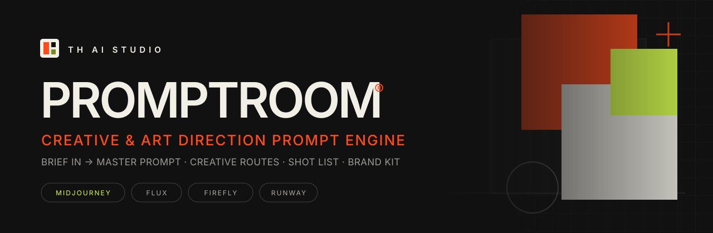
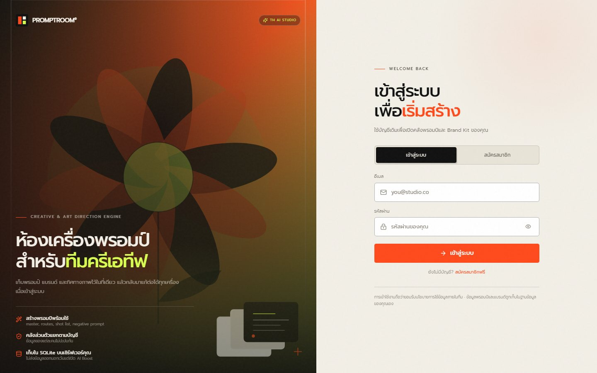
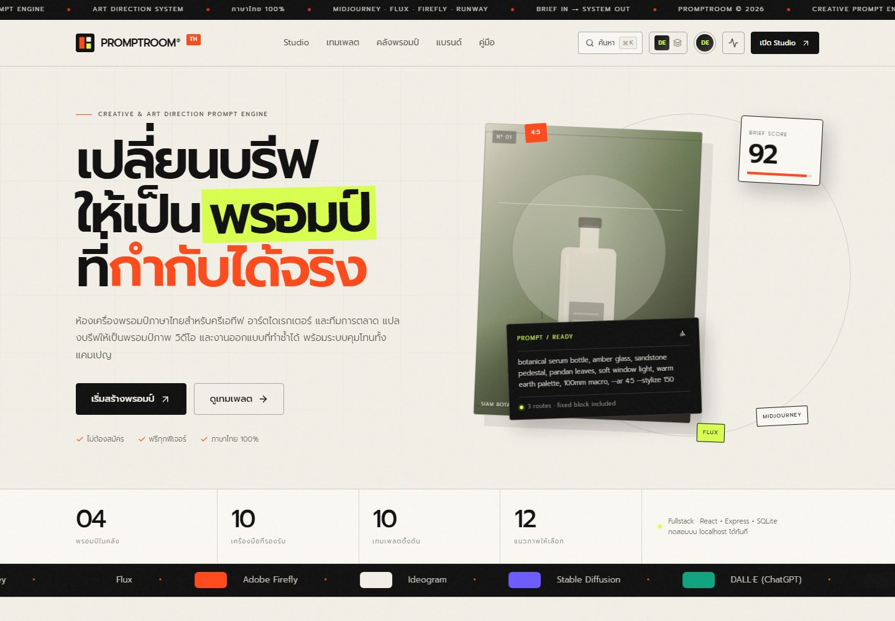
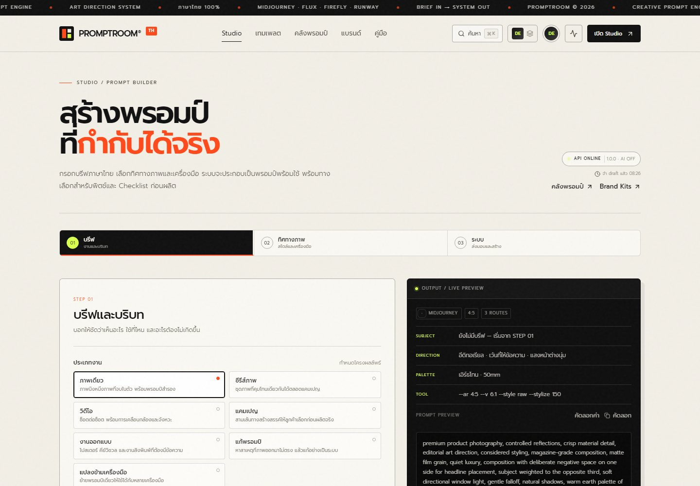
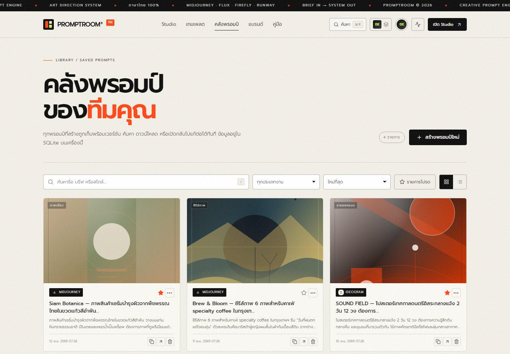
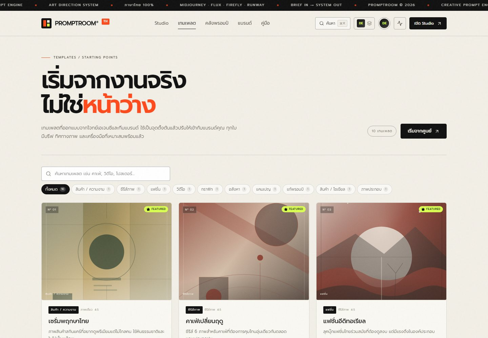
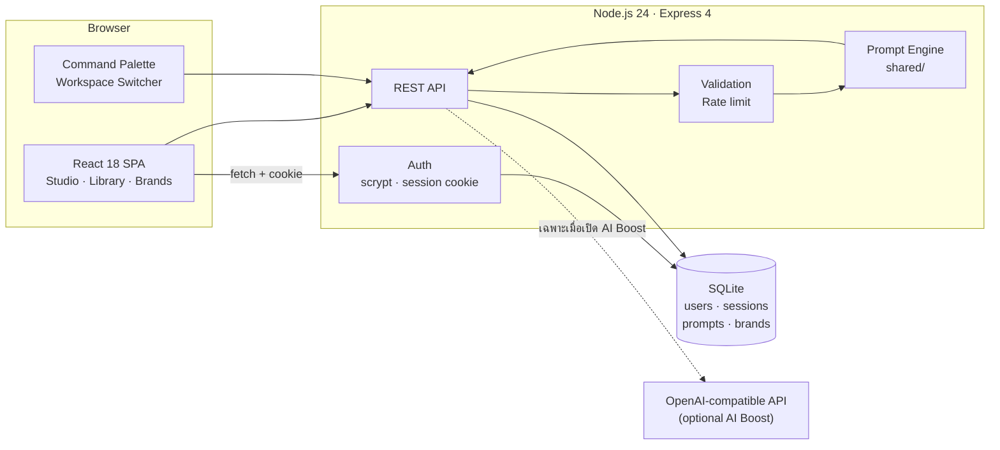

<div align="center">



# PROMPTROOM<sup>®</sup>

**ห้องเครื่องพรอมป์สำหรับทีมครีเอทีฟ** — เปลี่ยนบรีฟภาษาไทยให้เป็นพรอมป์ที่มีโครงสร้าง พร้อมกำกับภาพ ซีรีส์ วิดีโอ แคมเปญ และงานดีไซน์

[](https://react.dev)
[](https://www.typescriptlang.org)
[](https://nodejs.org)
[](https://expressjs.com)
[](https://nodejs.org/api/sqlite.html)
[](#-การทดสอบ)
[](LICENSE)

[เริ่มใช้งาน](#-เริ่มใช้งานใน-3-นาที) · [ฟีเจอร์](#-ฟีเจอร์) · [ภาพหน้าจอ](#-ภาพหน้าจอ) · [API](#-api-reference) · [Deploy](#-ขึ้น-production) · [Roadmap](#-roadmap)

</div>

---

## ทำไมต้อง PROMPTROOM?

ทีมครีเอทีฟเสียเวลาไปกับการเขียนพรอมป์ซ้ำ ๆ และจำไม่ได้ว่าเวอร์ชันไหนคือเวอร์ชันที่ดีที่สุด PROMPTROOM รวมทุกอย่างไว้ในที่เดียว:

- **บรีฟไทย → พรอมป์อังกฤษพร้อมใช้** โดยไม่ต้องเดาโครงสร้าง
- **Master prompt + creative routes + shot list + negative prompt** ในครั้งเดียว
- **คลังพรอมป์และ Brand Kit ส่วนตัว** แยกตามบัญชี กลับมาแก้ต่อได้ทุกเครื่อง
- **พารามิเตอร์เฉพาะเครื่องมือ** เช่น Midjourney, FLUX, Firefly, Runway, Sora

> [!NOTE]
> เว็บทำงานได้ครบทุกฟีเจอร์โดยไม่ต้องมี API key ของ AI ใด ๆ — prompt engine เป็น deterministic และทำงานในเครื่องทั้งหมด ส่วน **AI Boost** เป็นฟีเจอร์เสริมสำหรับขัดเกลาถ้อยคำเท่านั้น

---

## ✨ ภาพหน้าจอ

<div align="center">

### หน้าเข้าสู่ระบบ / สมัครสมาชิก


<table>
  <tr>
    <td width="50%"><br /><sub><b>Home</b> — ภาพรวมและทางเข้า Studio</sub></td>
    <td width="50%"><br /><sub><b>Studio</b> — วิซาร์ด 3 ขั้น พร้อม live preview</sub></td>
  </tr>
  <tr>
    <td width="50%"><br /><sub><b>Library</b> — ค้นหา กรอง และจัดการพรอมป์ที่บันทึกไว้</sub></td>
    <td width="50%"><br /><sub><b>Templates</b> — 10 จุดเริ่มต้นจากงานจริง</sub></td>
  </tr>
</table>

</div>

---

## 🚀 ฟีเจอร์

### Prompt Engine

| ความสามารถ | รายละเอียด |
| --- | --- |
| **Master Prompt** | โครงสร้าง `ROLE / GOAL / CONTEXT / VISUAL DIRECTION / DELIVERABLES / CONSTRAINTS / CHECKS` |
| **Creative Routes** | 3–4 ทิศทางภาพที่แตกต่างกัน ให้เลือกหรือทดลองต่อ |
| **Shot List** | ตารางช็อตสำหรับซีรีส์/วิดีโอ พร้อมเฟรม ขนาดภาพ และ negative prompt |
| **Tool Presets** | แปลงเป็นพารามิเตอร์ของ Midjourney, FLUX, Firefly, Ideogram, Stable Diffusion, DALL·E, Runway, Kling, Sora และ generic |
| **Readiness Score** | ประเมินความพร้อมของบรีฟก่อนนำไปใช้ |
| **Deterministic** | ผลลัพธ์ซ้ำได้ ทำงานได้แม้ออฟไลน์ และไม่ส่งข้อมูลออกนอกเซิร์ฟเวอร์ |

### พื้นที่ทำงาน

- **Studio** — วิซาร์ด 3 ขั้น (บรีฟ → ทิศทางภาพ → สรุป), autosave draft, randomize, template/brand picker, `Ctrl/Cmd + Enter`
- **Library** — ค้นหา กรองตามงาน/สไตล์/รายการโปรด, เรียงลำดับ, grid/list, duplicate, rename, download, deep link `?prompt=<id>`
- **Templates** — 10 เทมเพลตคัดสรร พร้อม preview พรอมป์จริงก่อนใช้งาน
- **Brands** — Brand Kit (โทนเสียง, กลุ่มเป้าหมาย, พาเลตต์, คำห้าม) ใช้เป็น context อัตโนมัติ
- **Guide** — คู่มือเขียนพรอมป์พร้อม scroll-spy และปุ่มคัดลอกตัวอย่าง
- **Command Palette** — `Ctrl/Cmd + K` ค้นหาหน้า เทมเพลต เครื่องมือ และคำสั่ง
- **Workspace Switcher** — แยกคลังตามทีม/ลูกค้าภายในบัญชีเดียว

### UX / UI

- ดีไซน์ cream / ink / accent พร้อมฟอนต์ **Prompt** ทั้งเว็บ
- Popover และ Modal ที่รองรับ keyboard, focus trap และ collision detection
- Toast, skeleton loading, empty state, error state และ progress bar
- Responsive ถึง 390px พร้อม mobile dock
- รองรับ `prefers-reduced-motion`, print styles, skip link และ ARIA labels
- Export เป็น **Markdown / JSON / CSV shot list / TXT** และคัดลอกลิงก์แชร์

### Authentication & Security

- สมัครสมาชิก / เข้าสู่ระบบด้วยอีเมลและรหัสผ่าน
- รหัสผ่าน hash ด้วย **scrypt** + salt แบบสุ่ม
- Session cookie `pr_session` แบบ **HttpOnly, SameSite=Lax, 30 วัน**
- ทุก API ใต้ `/api` (ยกเว้น health/templates/auth) ต้องเข้าสู่ระบบ
- ข้อมูลแยกตามบัญชีจริงด้วย workspace scope `${user.id}:${workspace}`
- บัญชีใหม่ได้พรอมป์ตัวอย่าง 4 รายการและ Brand Kit 3 ชุดทันที
- Rate limit, validation ภาษาไทย, body limit 1MB และ security headers

---

## 🧠 ผลลัพธ์ที่ได้

ทุกครั้งที่กดสร้าง ระบบจะคืนผลลัพธ์ครบชุด:

```text
ROLE            Creative director / art director
GOAL            ภาพสินค้าเซรั่มจากพืชพรรณไทยสำหรับแคมเปญเปิดตัว
CONTEXT         แบรนด์ Siam Botanica · กลุ่มเป้าหมายผู้รักสกินแคร์ธรรมชาติ
VISUAL DIRECTION editorial · warm earth · soft window light · 85mm
DELIVERABLES    ภาพหลัก 1 ภาพ + 3 creative routes + shot list 4 ช็อต
CONSTRAINTS     ห้ามข้อความบนภาพ · ห้ามโลโก้เกิน 1 จุด · พื้นที่ปลอดภัยสำหรับครอป
CHECKS          ความสม่ำเสมอของแสง · สีผิว · วัสดุ · composition
```

พร้อม:

- **3–4 creative routes** ที่มีแนวคิดและพารามิเตอร์ต่างกัน
- **Shot table** สำหรับซีรีส์และวิดีโอ
- **Negative prompt** แยกตามเครื่องมือ
- **Tool parameters** เช่น `--ar 4:5 --v 6.1 --style raw --stylize 150`
- **JSON** สำหรับนำไปต่อกับระบบอื่น

---

## 🛠️ Tech Stack

| ชั้น | เทคโนโลยี |
| --- | --- |
| Frontend | React 18, React Router 6, TypeScript, Vite 6 |
| Styling | CSS design system (`styles.css`) + enhancement layer (`enhance.css`) |
| Icons / Artwork | Lucide React + deterministic inline SVG |
| Backend | Express 4, TypeScript (tsx), Node.js 24+ |
| Database | SQLite ผ่าน `node:sqlite` (ไม่ต้องคอมไพล์ native module) |
| Auth | scrypt + session cookie (HttpOnly, SameSite=Lax) |
| Validation | custom validators ภาษาไทย |
| Tests | `node:test` + `tsx` (integration ผ่าน HTTP จริง) |
| Deploy | Docker, PM2, systemd, Caddy/Nginx |
| Local ops | Control Center (start/stop/restart/build/logs) |

---

## 🏗️ Architecture



จุดสำคัญ:

- `shared/` ถูกใช้ร่วมกันทั้ง frontend และ backend ทำให้ preview กับผลลัพธ์จริงตรงกัน
- Frontend ถูกเสิร์ฟจาก Express เดียวกันใน production (SPA fallback รองรับ deep link)
- ฐานข้อมูลเป็นไฟล์เดียว สำรองง่ายด้วย `VACUUM INTO`

---

## 📁 โครงสร้างโปรเจกต์

```text
PROMPTROOM/
├─ shared/                  # prompt engine, options, templates, types
│  ├─ engine.ts             # สร้าง master prompt, routes, shots, checks
│  ├─ options.ts            # งาน, เครื่องมือ, สไตล์, แสง, พาเลตต์, เลนส์
│  └─ templates.ts          # 10 เทมเพลตเริ่มต้น
├─ server/
│  ├─ index.ts              # entry point
│  ├─ app.ts                # createApp(), routes, error handling
│  ├─ auth.ts               # scrypt, session, requireAuth, scoped workspace
│  ├─ db.ts                 # schema, queries, seed
│  ├─ validate.ts           # request validation (ข้อความไทย)
│  ├─ rate-limit.ts         # in-memory rate limiter
│  ├─ normalize.ts
│  └─ env.ts
├─ src/
│  ├─ pages/                # Home, Studio, Templates, Library, Brands, Guide, Auth, 404
│  ├─ components/           # Layout, ResultView, Popover, Modal, Artwork, Illustration…
│  ├─ lib/                  # api client, auth context, utils
│  ├─ styles.css            # design system
│  └─ enhance.css           # UX/UI enhancement layer
├─ tests/api.test.ts        # 19 integration tests
├─ control-center/          # Local Control Center (bind 127.0.0.1 เท่านั้น)
├─ scripts/backup-db.mjs    # SQLite backup
├─ docs/                    # banner + screenshots
├─ Dockerfile
├─ ecosystem.config.cjs     # PM2
├─ .env.example
└─ package.json
```

---

## ⚡ เริ่มใช้งานใน 3 นาที

### สิ่งที่ต้องมี

- **Node.js 24 หรือใหม่กว่า** (ต้องมี `node:sqlite`)
- npm 10+
- Windows, macOS หรือ Linux

```bash
node -v   # ต้องขึ้น v24.x ขึ้นไป
npm -v
```

### ติดตั้ง

```bash
git clone https://github.com/ikisawa77/PROMPTROOM.git
cd PROMPTROOM
npm install
cp .env.example .env
npm run build
npm start
```

บน Windows PowerShell ใช้ `Copy-Item .env.example .env` แทน `cp`

เปิด **http://localhost:8787** แล้วสมัครสมาชิกเพื่อเริ่มใช้งาน

> [!TIP]
> ไม่ต้องสร้าง `.env` ก็รันได้ ระบบจะใช้ `PORT=8787` และปิด AI Boost ให้อัตโนมัติ

### โหมดพัฒนา

```bash
npm run dev
```

เปิด **http://localhost:5173** — Vite proxied `/api` ไปที่ `localhost:8787` พร้อม hot reload ทั้งสองฝั่ง

---

## ⚙️ Environment Variables

| ตัวแปร | ค่าเริ่มต้น | คำอธิบาย |
| --- | --- | --- |
| `PORT` | `8787` | พอร์ตของเว็บแอป |
| `HOST` | `0.0.0.0` | `127.0.0.1` = รับเฉพาะเครื่องนี้ |
| `NODE_ENV` | `production` | โหมดการทำงาน |
| `DATA_DIR` | `./data` | โฟลเดอร์เก็บ SQLite (ต้องเป็น persistent disk) |
| `DB_PATH` | `$DATA_DIR/promptroom.db` | ระบุไฟล์ฐานข้อมูลตรง ๆ |
| `COOKIE_SECURE` | `0` | ตั้ง `1` เมื่อให้บริการผ่าน HTTPS |
| `RATE_LIMIT_DISABLED` | `0` | ตั้ง `1` เพื่อปิด rate limit (เฉพาะ test) |
| `OPENAI_API_KEY` | — | เปิด AI Boost (ไม่ใส่ก็ใช้แอปได้ครบ) |
| `OPENAI_BASE_URL` | `https://api.openai.com/v1` | รองรับ OpenAI-compatible endpoint |
| `OPENAI_MODEL` | `gpt-4o-mini` | โมเดลที่ใช้ boost |
| `CONTROL_PORT` | `9090` | พอร์ต Local Control Center |
| `APP_PORT` | `8787` | พอร์ตที่ Control Center ใช้ตรวจสุขภาพ |

---

## 📜 Scripts

| คำสั่ง | ทำอะไร |
| --- | --- |
| `npm run dev` | รัน API + Vite พร้อมกัน (port 8787 / 5173) |
| `npm run dev:server` | รันเฉพาะ API (tsx watch) |
| `npm run dev:client` | รันเฉพาะ Vite |
| `npm run build` | typecheck แล้ว build ลง `dist/` |
| `npm start` | เสิร์ฟ production จาก `dist/` |
| `npm test` | รัน integration tests 19 รายการ |
| `npm run typecheck` | ตรวจ TypeScript อย่างเดียว |
| `npm run backup` | สำรอง SQLite ไป `data/backups/` (เก็บ 14 ชุด) |
| `npm run control` | เปิด Local Control Center ที่ 9090 |

บน Windows ดับเบิลคลิก `start-app.bat` หรือ `start-control-center.bat` ได้เลย

---

## 🔐 Authentication & Security

### วิธีทำงาน

1. ผู้ใช้สมัครหรือเข้าสู่ระบบผ่าน `/auth`
2. เซิร์ฟเวอร์ hash รหัสผ่านด้วย **scrypt** (N=16384, r=8, p=1) พร้อม salt 16 bytes
3. ออก session token แบบสุ่ม 32 bytes และเก็บเฉพาะ **SHA-256 hash** ในฐานข้อมูล
4. ส่ง cookie `pr_session` แบบ `HttpOnly; SameSite=Lax; Path=/; Max-Age=30d`
5. ทุก request ที่เข้า `/api` ถูกตรวจสิทธิ์ด้วย middleware `requireAuth`

### การแยกข้อมูล

Workspace ของผู้ใช้แต่ละคนถูก scope เป็น:

```text
<user.id>:<workspace-name>
```

แม้ผู้ใช้สองคนจะตั้งชื่อ workspace เหมือนกัน (`shared-client`) ข้อมูลก็ไม่ปะปนกัน และการอ่านพรอมป์ข้ามบัญชีจะได้ `404`

### สิ่งที่ควรทำเมื่อขึ้น production

- เปิด HTTPS และตั้ง `COOKIE_SECURE=1`
- อย่า deploy `control-center/` สู่สาธารณะ (มันสั่ง start/stop process ได้)
- ตั้ง backup ฐานข้อมูลรายวัน
- จำกัด body size ที่ reverse proxy ให้สอดคล้องกับ 1MB

---

## 🔌 API Reference

endpoint ที่เกี่ยวกับข้อมูลจะใช้ header `x-workspace` เพื่อเลือก workspace (ค่าเริ่มต้น `demo`) และถูก scope ตามบัญชีผู้ใช้อีกชั้นหนึ่ง

### Public

| Method | Path | ใช้ทำอะไร |
| --- | --- | --- |
| `GET` | `/api/health` | สถานะเซิร์ฟเวอร์, uptime, AI enabled |
| `GET` | `/api/templates` | รายการเทมเพลตทั้งหมด |
| `POST` | `/api/auth/register` | สมัครสมาชิกและออก session |
| `POST` | `/api/auth/login` | เข้าสู่ระบบ |
| `POST` | `/api/auth/logout` | ออกจากระบบและล้าง cookie |
| `GET` | `/api/auth/me` | ข้อมูลผู้ใช้ปัจจุบัน (คืน `{ user: null }` เมื่อยังไม่ login) |

### ต้องเข้าสู่ระบบ

| Method | Path | ใช้ทำอะไร |
| --- | --- | --- |
| `GET` | `/api/stats` | สถิติคลังพรอมป์และแบรนด์ |
| `POST` | `/api/generate` | สร้างพรอมป์แบบเต็มและบันทึก |
| `POST` | `/api/generate/preview` | สร้างพรอมป์แบบไม่บันทึก |
| `GET` | `/api/prompts` | ค้นหาคลัง (`?q=&task=&favorite=`) |
| `GET` | `/api/prompts/:id` | ดูรายการเดียว |
| `PATCH` | `/api/prompts/:id` | เปลี่ยนชื่อ / favorite |
| `DELETE` | `/api/prompts/:id` | ลบ |
| `POST` | `/api/prompts/:id/duplicate` | ทำสำเนา |
| `GET` | `/api/brands` | รายการ Brand Kit |
| `POST` | `/api/brands` | เพิ่ม Brand Kit |
| `PATCH` | `/api/brands/:id` | แก้ไข |
| `DELETE` | `/api/brands/:id` | ลบ |
| `POST` | `/api/boost` | ขัดเกลาพรอมป์ด้วย AI (ต้องมี key) |

### ตัวอย่าง

```bash
# สมัครสมาชิก
curl -i -X POST http://localhost:8787/api/auth/register \
  -H 'Content-Type: application/json' \
  -d '{"name":"Napa","email":"napa@studio.co","password":"promptroom123"}'

# สร้างพรอมป์ (ใช้ cookie จาก response ก่อนหน้า)
curl -X POST http://localhost:8787/api/generate \
  -H 'Content-Type: application/json' \
  -H 'x-workspace: demo' \
  -b 'pr_session=...' \
  -d '{"input":{"brief":"ภาพสินค้าเซรั่มจากพืชพรรณไทย","task":"image","tool":"midjourney","style":"editorial"}}'
```

### Validation & Rate limits

- ข้อมูลผิดรูปแบบ → `400` พร้อมข้อความภาษาไทย
- JSON ผิดรูปแบบ → `400`, body เกิน 1MB → `413`
- `/api/generate` 30 ครั้ง/นาที
- `/api/generate/preview` 60 ครั้ง/นาที
- `/api/boost` 12 ครั้ง/นาที
- `/api/auth/*` 20 ครั้ง/นาที
- เกิน limit → `429` พร้อม header `Retry-After`

Rate limit แยกตาม **IP + workspace** และเก็บใน memory (รีเซ็ตเมื่อรีสตาร์ท)

---

## 🗄️ ข้อมูลและการสำรอง

- ฐานข้อมูล: `data/promptroom.db` (SQLite WAL)
- ตาราง: `prompts`, `brands`, `users`, `sessions`
- บัญชีใหม่ถูก seed พร้อมพรอมป์ 4 รายการและ Brand Kit 3 ชุด

```bash
npm run backup              # เก็บ 14 ชุดล่าสุด
node scripts/backup-db.mjs 30
```

สคริปต์ใช้ `VACUUM INTO` จึงได้ snapshot ที่ consistent แม้เซิร์ฟเวอร์กำลังทำงาน

**กู้คืน:** หยุดเซิร์ฟเวอร์ → คัดลอกไฟล์สำรองทับ `data/promptroom.db` (ลบ `-wal`/`-shm` เก่าด้วย) → เริ่มใหม่

---

## 🧪 การทดสอบ

```bash
npm run typecheck
npm test
npm run build
```

ชุดทดสอบครอบคลุม:

- public routes และการป้องกัน `401` ของ protected routes
- validation ของการสมัคร (อีเมลซ้ำ, รหัสสั้น)
- login สำเร็จ/ล้มเหลว และ `/api/auth/me`
- การแยกข้อมูลระหว่างบัญชี (cross-account isolation)
- prompt lifecycle: create → list → read → patch → duplicate → delete
- brand lifecycle และการ normalize พาเลตต์
- seed data ของบัญชีใหม่
- malformed JSON, body validation และ rate limit `429`
- AI Boost ตอบ `503` เมื่อไม่มี key

ผลล่าสุด: **19/19 ผ่าน**

---

## 🚢 ขึ้น Production

### 1. เตรียม environment

```dotenv
NODE_ENV=production
PORT=8787
HOST=0.0.0.0
DATA_DIR=/srv/promptroom/data
COOKIE_SECURE=1
OPENAI_API_KEY=          # ไม่ใส่ก็ได้
```

ต้องมี **persistent disk** mount ที่ `DATA_DIR` และใช้ Node.js 24+

### 2. Build และรัน

```bash
npm ci
npm run build
npm test
npm start
```

### 3. Docker

```bash
docker build -t promptroom .
docker run -d --name promptroom -p 127.0.0.1:8787:8787 \
  -v promptroom-data:/app/data --env-file .env promptroom
```

### 4. PM2

```bash
npm i -g pm2
pm2 start ecosystem.config.cjs
pm2 save
pm2 startup
```

### 5. systemd

```ini
[Unit]
Description=PROMPTROOM
After=network.target

[Service]
Type=simple
WorkingDirectory=/srv/promptroom
ExecStart=/usr/bin/npm start
Restart=always
RestartSec=3
Environment=NODE_ENV=production
Environment=PORT=8787
Environment=HOST=127.0.0.1
Environment=DATA_DIR=/srv/promptroom/data
Environment=COOKIE_SECURE=1

[Install]
WantedBy=multi-user.target
```

### 6. Reverse proxy + HTTPS

**Caddy**

```caddyfile
prompt.example.com {
  encode gzip
  reverse_proxy 127.0.0.1:8787
}
```

**Nginx**

```nginx
server {
  listen 443 ssl http2;
  server_name prompt.example.com;

  location / {
    proxy_pass http://127.0.0.1:8787;
    proxy_http_version 1.1;
    proxy_set_header Host $host;
    proxy_set_header X-Forwarded-For $proxy_add_x_forwarded_for;
    proxy_set_header X-Forwarded-Proto $scheme;
    proxy_read_timeout 90s;
  }
}
```

แพลตฟอร์มที่รองรับ Node.js 24+ และ persistent disk: VPS, Railway, Render, Fly.io

---

## 🎛️ Local Control Center

สำหรับเครื่อง developer เท่านั้น — ผูกกับ `127.0.0.1` เสมอ

```bash
npm run control
```

เปิด **http://localhost:9090**

- Start / Stop / Restart / Force Stop process tree
- Build production และ stream log
- Live logs ผ่าน SSE พร้อม filter / auto-scroll / download
- Preflight ตรวจ Node, dist, สิทธิ์เขียน data, พอร์ต, health API, `.env`
- Auto-restart เมื่อโปรเซสล้ม (สูงสุด 3 ครั้ง)
- Activity history ของทุกคำสั่ง

> [!WARNING]
> อย่าเปิด Control Center สู่อินเทอร์เน็ต — ถ้าต้องเข้าจากเครื่องอื่นให้ใช้ SSH tunnel

---

## 🎨 Design Language

| Token | ค่า | ใช้ที่ |
| --- | --- | --- |
| Cream | `#f2efe7` | พื้นหลังหลัก |
| Paper | `#faf8f2` / `#f5f2ea` | การ์ดและ surface |
| Ink | `#111111` | ตัวอักษรและ CTA หลัก |
| Accent | `#ff4a1c` | ไฮไลต์และปุ่มสำคัญ |
| Lime | `#d8ff4f` | สถานะพร้อมใช้และ decorative |
| Line | `rgba(17,17,17,.14)` | เส้นแบ่งและ border |

- ฟอนต์ **Prompt** ทั้งเว็บ รวมถึง code block
- ระยะห่างแบบ editorial, เส้น grid, ตัวเลขใหญ่ และมุมเหลี่ยมเล็กน้อย
- Artwork เป็น SVG deterministic จาก seed — ไม่ต้องโหลดรูปจากภายนอก

---

## 🗺️ Roadmap

- [x] Prompt engine ครบชุด (master, routes, shot list, negative, tool params)
- [x] Authentication และ per-user workspace isolation
- [x] Library, Templates, Brands, Guide และ Command Palette
- [x] Export Markdown / JSON / CSV / TXT
- [x] Integration tests และ rate limiting
- [x] Docker, PM2, systemd และ backup script
- [ ] Prompt versioning และ diff ระหว่างเวอร์ชัน
- [ ] Image reference board
- [ ] Batch generate
- [ ] Team roles & permissions
- [ ] Custom tool presets
- [ ] PDF export

---

## 🩺 แก้ปัญหาที่พบบ่อย

| อาการ | วิธีแก้ |
| --- | --- |
| `Cannot find module 'node:sqlite'` | อัปเกรด Node.js เป็น 24 ขึ้นไป |
| เปิดเว็บแล้ว 404 / หน้าว่าง | ยังไม่มี `dist/` — รัน `npm run build` ก่อน `npm start` |
| พอร์ต 8787 ถูกยึด | `Get-NetTCPConnection -LocalPort 8787 -State Listen` หรือใช้ Kill port owner ใน Control Center |
| ล็อกอินแล้วเด้งกลับ `/auth` | ตรวจว่า cookie ไม่ถูกบล็อก และใช้ origin เดียวกัน |
| Session หายหลัง deploy | ยังไม่ได้ตั้ง `COOKIE_SECURE=1` บน HTTPS หรือไม่มี persistent disk |
| AI Boost ขึ้น 503 | ยังไม่ได้ตั้ง `OPENAI_API_KEY` แล้วรีสตาร์ทเซิร์ฟเวอร์ |
| ฟอนต์ไม่โหลด | หน้าเว็บเรียก Google Fonts — ต้องต่ออินเทอร์เน็ต หรือ host ฟอนต์เอง |

---

## 🤝 Contributing

1. Fork repository
2. สร้าง branch ใหม่: `git checkout -b feat/your-feature`
3. Commit: `git commit -m "feat: add your feature"`
4. Push และเปิด Pull Request

ก่อนส่ง PR กรุณารัน:

```bash
npm run typecheck && npm test && npm run build
```

---

## 📄 License

Released under the **GNU General Public License v3.0** — ดูรายละเอียดใน [LICENSE](LICENSE)

---

<div align="center">


**PROMPTROOM®** — brief in, system out.

สร้างโดยทีมครีเอทีฟ iParnZ MDSeed.net สำหรับทีมครีเอทีฟ · ภาษาไทย 100%

</div>
